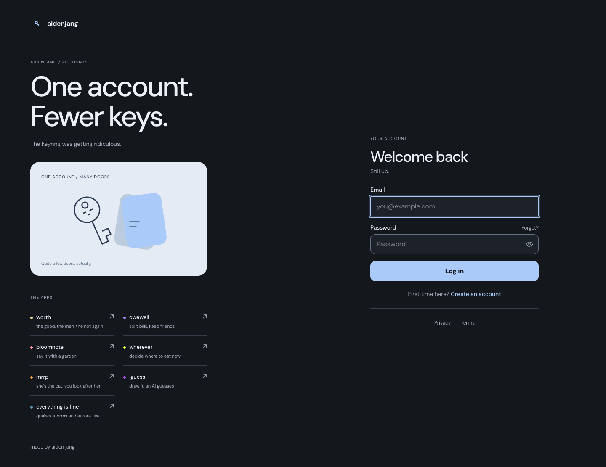

# Accounts

The shared sign-in and account hub for Aiden Jang’s apps, at
[accounts.aidenjang.com](https://accounts.aidenjang.com). Sign in with a password, Google, or a
passkey; manage devices, recover access, and download or delete the identity account.



A Cloudflare Worker serves the Hono API and React UI together. D1 stores identity and hashed
sessions; a Durable Object limits abusive requests. Other apps resolve identity server-side through
[`@aidenjang/auth-client`](packages/client), the separately published SDK.

## Run locally

Use Node 22 from `.nvmrc` and the pnpm version pinned in `package.json`.

```sh
corepack enable
pnpm install --frozen-lockfile
pnpm run build
pnpm --filter @aidenjang/auth-api run db:migrate:local
```

Start the API and web UI in separate terminals:

```sh
pnpm --filter @aidenjang/auth-api run dev
pnpm --filter @aidenjang/auth-web run dev
```

Open `http://localhost:34110`; the local Worker runs on port 34100. Apply migrations before using a
fresh local D1. With an explicit HTTP(S) loopback `APP_URL` and no email provider key, local mail is printed
to the Worker log. Other origins require the mail provider; message contents are never logged.
Optional local secrets belong in the ignored `.dev.vars` file in `packages/api`; see
[the API runbook](packages/api/DEPLOY.md). Never use production credentials for tests.

## Verify

```sh
pnpm --filter @aidenjang/auth-web exec playwright install --with-deps chromium webkit
pnpm run verify
```

This runs types, lint, unused-code and size checks, docs/comments/migration guards, the full
dependency audit, builds, unit suites, and browser journeys. `verify:fast` runs the repository gates;
`verify:core` adds builds and unit tests. Browser tests own their local servers, database migrations,
synthetic accounts, and dev-mail log. They test the built production configuration with a local
security-widget stub, while actual account journeys use local challenge-free development mode.
They do not contact Google, send email, or change production accounts. Desktop Chromium and
iPhone-sized WebKit run the journeys; physical keyboards, gestures and native sheets still need
a real-device check. Local HTTP tests pin the Worker’s upstream to loopback so cookies and asset
URLs use the development origin.

CI runs `verify:core` and browser journeys in parallel, retains the checked web bundle and browser
evidence, and deploys only after both jobs pass. Merging to main triggers the existing automatic
deployment: D1 migrations first, then the Worker with that checked bundle.

## Repository map

| Path               | Responsibility                                                             |
| ------------------ | -------------------------------------------------------------------------- |
| `packages/api/`    | Identity API, sessions, passkeys/OAuth, mail, D1 schema and migrations     |
| `packages/web/`    | Sign-in, recovery, account management, legal pages and browser journeys    |
| `packages/client/` | Published session resolver and redirect URL builders for consuming Workers |
| `packages/config/` | Shared TypeScript and ESLint configuration                                 |
| `scripts/`         | Repository guards and operational helpers                                  |
| `docs/`            | API/security/runbooks and UI verification evidence                         |

[Architecture](ARCHITECTURE.md) explains the internal boundaries. [PLATFORM.md](PLATFORM.md) covers
the wider platform. The UI’s app registry owns visible launcher/return labels; consuming repositories
own their own account adoption and data. A service deployment does not publish the SDK.

## Security and data boundaries

The shared `platform_session` cookie is HttpOnly; D1 stores a SHA-256 hash of its value. The cookie
covers the parent domain in production, so sibling app origins are part of the platform’s trust
boundary. Apps forward the cookie from their own Worker to `/auth/me`; frontend code cannot read it.
An unavailable resolver must remain distinct from a signed-out user.

Sensitive credential changes require recent proof. Registration deliberately reports a taken email;
password-reset requests use the same successful response for known and unknown addresses. Transport
failures remain visible so users can retry. Auth responses are never cached. Reset and verification
links are credentials: do not paste them in issues, screenshots, or analytics.

For vulnerabilities, use [private reporting](https://github.com/aiden-jang/auth/security/advisories/new),
not public issues. See [security](docs/SECURITY.md) for the implemented controls and remaining limits.

## Contribute and operate

- [CONTRIBUTING.md](CONTRIBUTING.md): development, validation, migrations, and SDK publishing.
- [API reference](docs/API.md): routes, response codes, and the shared session contract.
- [Deployment](docs/DEPLOY-CHECKLIST.md): automatic deployment, recovery, and rollback.
- [Observability](docs/OBSERVABILITY.md): request IDs, logs, events, and health checks.
- [Design](docs/DESIGN.md) and [UI evidence](docs/ui-qa/README.md).

## Sharing preview

The committed slate/ice-blue preview at `/og.png` contains static branding, with no account or return
destination data. Regenerate its SVG and PNG with `pnpm --filter @aidenjang/auth-web run gen:og`.
The same PNG is suitable for the repository’s optional GitHub social preview.

Aggregate traffic and feature-event coverage, privacy boundaries and queries: [Analytics](docs/ANALYTICS.md).
